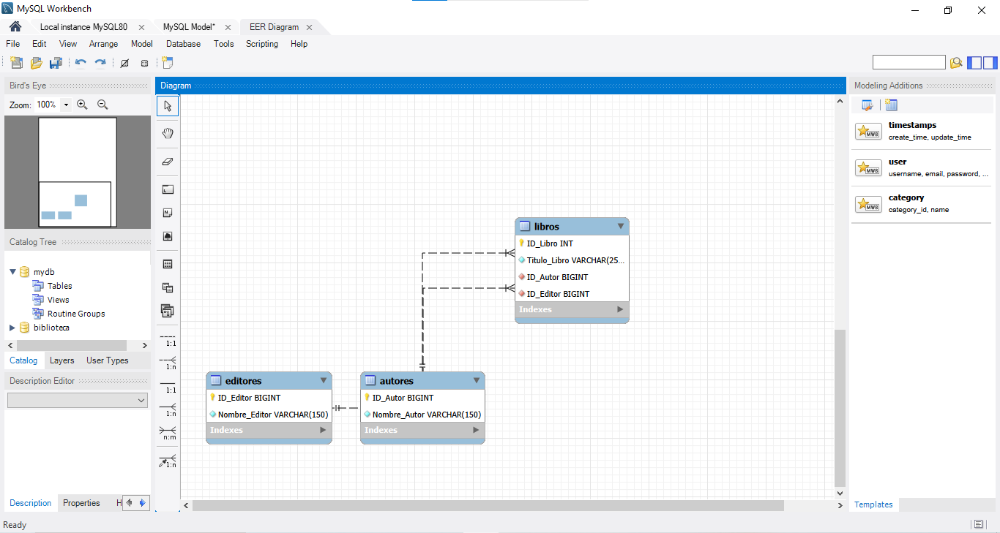

# Sistema de Registro de Libros - Base de Datos en Tercera Forma Normal (3FN)

Proyecto de diseño, modelado e implementación de una base de datos relacional para la gestión de una biblioteca, optimizada bajo la **Tercera Forma Normal (3FN)** para garantizar la integridad y eficiencia de los datos.

## 🛠️ Tecnologías Utilizadas
* **Motor de Base de Datos:** MySQL / MySQL Workbench
* **Modelado:** Diagramas Entidad-Relación (EER)

---

## 📂 Estructura del Proyecto
El repositorio contiene los siguientes elementos para su evaluación y ejecución:
1. `biblioteca.sql`: Script completo de creación de base de datos, tablas, índices, restricciones (Foreign Keys) e inserción de datos de prueba (DML).
2. `README.md`: Documentación técnica del proyecto.
3. Carpeta `images/`: Evidencias visuales del diagrama relacional y pruebas de integridad.

---

## 📊 1. Diagrama Entidad-Relación (EER)
El modelo consta de tres tablas principales (`autores`, `editores`, `libros`) vinculadas mediante relaciones de uno a muchos (1:N), cumpliendo con los principios de normalización.

* **Vista del Modelo en MySQL Workbench:**
  

---

## ⚙️ 2. Decisiones de Integridad Referencial
En el diseño de las llaves foráneas (`FK`) de la tabla `libros`, se implementaron las siguientes reglas de comportamiento:
* **`ON DELETE RESTRICT`**: Evita la eliminación accidental de un autor o editor si este todavía tiene libros registrados en el sistema, previniendo pérdida de información crítica.
* **`ON UPDATE CASCADE`**: Si la clave primaria de un autor o editor sufre una actualización o cambio, este se propaga de manera automática en los registros asociados de la tabla `libros`.

---

## 📈 3. Justificación Teórica de la Normalización (3FN)
* **Primera Forma Normal (1FN):** Todos los atributos son atómicos y contienen valores individuales; no existen grupos repetidos ni columnas múltiples para un mismo dato.
* **Segunda Forma Normal (1FN + Sin dependencias parciales):** Las claves primarias de cada tabla son simples (`SERIAL` / `INT`), lo que descarta por completo la existencia de dependencias parciales.
* **Tercera Forma Normal (2FN + Sin dependencias transitivas):** Se eliminaron las dependencias transitivas aislando los datos de los autores y editores en sus respectivas tablas (`autores`, `editores`). En la tabla `libros` únicamente residen las claves foráneas, logrando que cada atributo no clave dependa única y exclusivamente de la clave primaria de su propia entidad.
