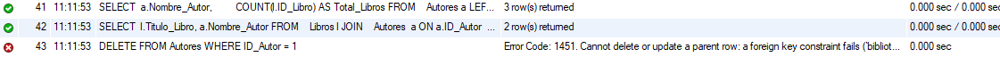
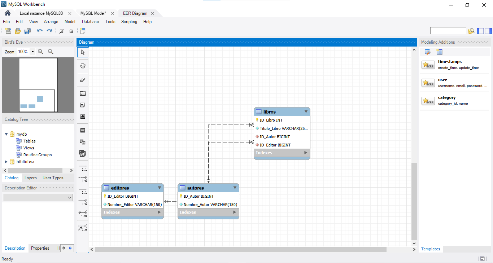

# Sistema de Registro de Libros - Base de Datos en 3FN

Este proyecto contiene el diseño, normalización y script de ejecución en SQL (MySQL) para un sistema de gestión de biblioteca, garantizando la eliminación de redundancias y la preservación de la integridad referencial.

---

## 📋 Tabla de Contenidos
1. [Diseño del Esquema y Normalización (3FN)](#1-diseño-del-esquema-y-normalización-3fn)
2. [Diagrama Entidad-Relación (EER)](#2-diagrama-entidad-relación-eer)
3. [Estructura del Código SQL (DDL y DML)](#3-estructura-del-código-sql-ddl-y-dml)
4. [Pruebas de Integridad Referencial](#4-pruebas-de-integridad-referencial)

---

## 1. Diseño del Esquema y Normalización (3FN)

El objetivo principal de este diseño es garantizar la **Tercera Forma Normal (3FN)**:

* **Primera Forma Normal (1FN):** Todos los atributos contienen valores atómicos e indivisibles. Cada tabla posee una clave primaria única (`ID_Autor`, `ID_Editor`, `ID_Libro`).
* **Segunda Forma Normal (2FN):** Se cumple 1FN y todos los atributos no clave dependen de la totalidad de la clave primaria. Como las claves primarias son simples (un solo atributo autoincremental), no existen dependencias parciales.
* **Tercera Forma Normal (3FN):** Se eliminan las dependencias transitivas. En un diseño no normalizado, la tabla `Libros` contendría directamente `Nombre_Autor` y `Nombre_Editor`, lo que provocaría la dependencia transitiva:
  $$\text{ID\_Libro} \rightarrow \text{ID\_Autor} \rightarrow \text{Nombre\_Autor}$$
  $$\text{ID\_Libro} \rightarrow \text{ID\_Editor} \rightarrow \text{Nombre\_Editor}$$

Al separar la información en las tablas independientes `Autores` y `Editores`, y vincularlas mediante llaves foráneas (`FK`), cada dato se almacena una sola vez, eliminando las anomalías de inserción, actualización y borrado.

---

## 2. Diagrama Entidad-Relación (EER)

A continuación se presenta el Diagrama Entidad-Relación generado automáticamente en MySQL Workbench mediante *Reverse Engineering*:

<!-- 📸 ESPACIO PARA IMAGEN DEL DIAGRAMA -->
> **Instrucciones:** Sube la captura de pantalla de tu diagrama a la carpeta `images/` de tu repositorio con el nombre `diagrama_eer.png` para que se visualice a continuación.



---

## 3. Estructura del Código SQL (DDL y DML)

El script ejecutable realiza las siguientes operaciones:

1. **Creación de la Base de Datos:** `CREATE DATABASE IF NOT EXISTS biblioteca;`
2. **Definición de Tablas (DDL):**
   * `Autores`: Contiene `ID_Autor` (`BIGINT UNSIGNED AUTO_INCREMENT`) y `Nombre_Autor`.
   * `Editores`: Contiene `ID_Editor` (`BIGINT UNSIGNED AUTO_INCREMENT`) y `Nombre_Editor`.
   * `Libros`: Contiene `ID_Libro`, `Titulo_Libro` y las llaves foráneas `ID_Autor` e `ID_Editor`.
3. **Restricciones de Integridad:**
   * `ON DELETE RESTRICT`: Evita borrar un autor o editor si tiene libros asociados.
   * `ON UPDATE CASCADE`: Propaga cambios de ID automáticamente a la tabla de libros.
4. **Poblado de Datos (DML):** Inserción de 3 autores, 3 editores y 5 libros de prueba para validar relaciones y consultas (`JOIN`).

---

## 4. Pruebas de Integridad Referencial

Para validar la correcta configuración de las restricciones de clave foránea, se ejecutó la siguiente prueba de eliminación:

```sql
DELETE FROM Autores WHERE ID_Autor = 1;
```

### Resultado Esperado y Obtenido:
Como el Autor 1 (Gabriel García Márquez) tiene libros registrados en la tabla `Libros`, el motor de base de datos MySQL detiene la operación y lanza el error de restricción referencial `Error Code: 1451`.

<!-- 📸 ESPACIO PARA IMAGEN DEL ERROR 1451 -->
> **Instrucciones:** Sube la captura de pantalla del mensaje de error 1451 en el panel Action Output a la carpeta `images/` de tu repositorio con el nombre `prueba_error_1451.png`.



**Conclusión de la prueba:** La base de datos protege con éxito la consistencia de los datos, evitando que existan registros de libros huérfanos.